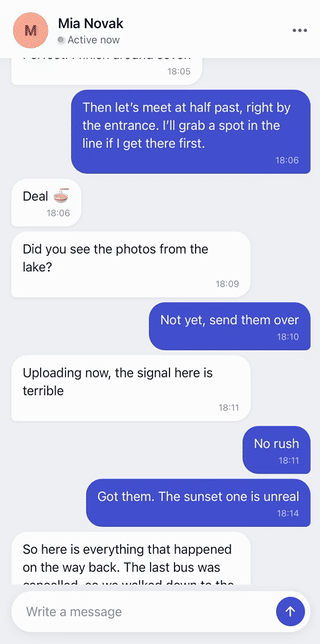
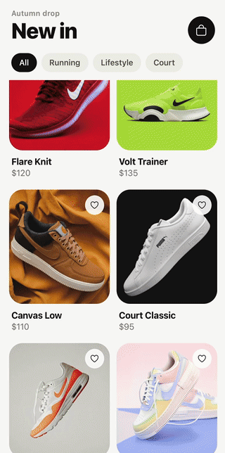

<div align="center">

# react-native-peek-menu

A performant, fully customizable long-press context menu for React Native.


&nbsp;&nbsp;&nbsp;


</div>

## Key features

- No native code
- Smooth animations
- Always stays on screen
- Fully customizable: the menu, the preview and the backdrop
- Opens above or below the content
- RTL support
- Portrait and landscape support

## Installation

Works with Expo and React Native CLI apps on the New Architecture.

Peer dependencies:

- `react-native-reanimated` >= 4.7
- `react-native-worklets` >= 0.13
- `react-native-gesture-handler` >= 3.3

First install and set up the peer dependencies by following their official guides:

- [Reanimated](https://docs.swmansion.com/react-native-reanimated/docs/fundamentals/getting-started)
- [Worklets](https://docs.swmansion.com/react-native-worklets/docs/fundamentals/getting-started)
- [Gesture Handler](https://docs.swmansion.com/react-native-gesture-handler/docs/fundamentals/installation)

Then install the library:

```sh
# Expo
npx expo install react-native-peek-menu

# React Native CLI
npm install react-native-peek-menu
```

## Quick start

Wrap your app in `PeekMenuProvider`, then wrap anything you want to hold in `PeekMenu`.

```tsx
import { Text, View } from 'react-native';
import { PeekMenu, PeekMenuProvider } from 'react-native-peek-menu';

export default function App() {
  return (
    <PeekMenuProvider>
      <PeekMenu
        items={[
          { title: 'Reply', onPress: reply },
          { title: 'Copy', onPress: copy },
          { title: 'Delete', destructive: true, onPress: remove },
        ]}
      >
        <View>
          <Text>Hold me</Text>
        </View>
      </PeekMenu>
    </PeekMenuProvider>
  );
}
```

## Recipes

### Safe area and a tab bar

Pass the safe area so the menu keeps clear of the notch and the home indicator. If the provider also covers a tab bar, add its height to `bottom`.

```tsx
import { PeekMenuProvider } from 'react-native-peek-menu';
import { useSafeAreaInsets } from 'react-native-safe-area-context';

const TAB_BAR_HEIGHT = 60;

function App() {
  const insets = useSafeAreaInsets();

  return (
    <PeekMenuProvider safeAreaInsets={{ ...insets, bottom: insets.bottom + TAB_BAR_HEIGHT }}>
      <Chat />
    </PeekMenuProvider>
  );
}
```

### Icons

`icon` takes any element. Its color isn't changed by `destructive` or the dark theme.

```tsx
import { PeekMenu } from 'react-native-peek-menu';

function ChatMessage({ message }: { message: Message }) {
  return (
    <PeekMenu
      items={[
        {
          title: 'Copy',
          icon: <CopyIcon />,
          onPress: () => copy(message),
        },
        {
          title: 'Share',
          icon: <ShareIcon />,
          iconPosition: 'left',
          onPress: () => share(message),
        },
      ]}
    >
      <Bubble message={message} />
    </PeekMenu>
  );
}
```

### Haptics on open

Add haptic feedback when a menu opens. Wrap `PeekMenu` once and use the wrapper across the app.

```tsx
import * as Haptics from 'expo-haptics';
import { PeekMenu, type PeekMenuProps } from 'react-native-peek-menu';

export function AppPeekMenu(props: PeekMenuProps) {
  return (
    <PeekMenu
      {...props}
      onOpen={() => {
        Haptics.impactAsync(Haptics.ImpactFeedbackStyle.Medium);
        props.onOpen?.();
      }}
    />
  );
}
```

### A custom backdrop

Replace the dimmed layer behind the menu with your own, like a blur that fades in and out with the menu.

```tsx
import { BlurView } from 'expo-blur';
import { StyleSheet } from 'react-native';
import { PeekMenuProvider, type PeekMenuBackdropProps } from 'react-native-peek-menu';
import Animated, { useAnimatedProps } from 'react-native-reanimated';

const AnimatedBlurView = Animated.createAnimatedComponent(BlurView);

function BlurBackdrop({ progress }: PeekMenuBackdropProps) {
  const animatedProps = useAnimatedProps(() => ({
    intensity: Math.min(progress.get(), 1) * 40,
  }));

  return (
    <AnimatedBlurView tint="dark" animatedProps={animatedProps} style={StyleSheet.absoluteFill} />
  );
}

function App() {
  return (
    <PeekMenuProvider renderBackdrop={(props) => <BlurBackdrop {...props} />}>
      <Chat />
    </PeekMenuProvider>
  );
}
```

On Android, `BlurView` shows a tinted layer instead of a blur unless you set up `blurTarget`, as described in the [expo-blur docs](https://docs.expo.dev/versions/latest/sdk/blur-view/).

### A custom menu

Restyle the list to match your app. Set `renderMenu` on `PeekMenuProvider` for every menu, or on a `PeekMenu` for one. Rows call `onItemPress`, which closes the menu and runs the item's `onPress`.

```tsx
import { Pressable, StyleSheet, Text, View } from 'react-native';
import { PeekMenuProvider, type PeekMenuRenderProps } from 'react-native-peek-menu';

function BrandMenu({ items, onItemPress }: PeekMenuRenderProps) {
  return (
    <View style={styles.menu}>
      {items.map((item) => (
        <Pressable key={item.title} onPress={() => onItemPress(item)} style={styles.row}>
          <Text style={[styles.title, item.destructive && styles.destructive]}>{item.title}</Text>
        </Pressable>
      ))}
    </View>
  );
}

function App() {
  return (
    <PeekMenuProvider renderMenu={(props) => <BrandMenu {...props} />}>
      <Chat />
    </PeekMenuProvider>
  );
}

const styles = StyleSheet.create({
  menu: {
    width: 240,
    maxWidth: '100%',
    borderRadius: 20,
    backgroundColor: '#1E1B4B',
  },
  row: {
    padding: 14,
  },
  title: {
    color: '#EEF2FF',
  },
  destructive: {
    color: '#FCA5A5',
  },
});
```

A custom menu needs a `width`, and `maxWidth: '100%'` keeps it on small screens.

### Anything as a menu

`renderMenu` can show any element instead of the list, like a row of reactions. Call `close` when it's done and pass it the action to run.

```tsx
import { Pressable, StyleSheet, Text, View } from 'react-native';
import { PeekMenu } from 'react-native-peek-menu';

const REACTIONS = ['❤️', '👍', '😂', '😮', '😢'];

function Reactions({ onSelect }: { onSelect: (emoji: string) => void }) {
  return (
    <View style={styles.reactions}>
      {REACTIONS.map((emoji) => (
        <Pressable key={emoji} onPress={() => onSelect(emoji)} style={styles.reaction}>
          <Text style={styles.emoji}>{emoji}</Text>
        </Pressable>
      ))}
    </View>
  );
}

function ChatMessage({ message }: { message: Message }) {
  return (
    <PeekMenu
      renderMenu={({ close }) => (
        <Reactions onSelect={(emoji) => close(() => react(message.id, emoji))} />
      )}
    >
      <Bubble message={message} />
    </PeekMenu>
  );
}

const styles = StyleSheet.create({
  reactions: {
    flexDirection: 'row',
    gap: 4,
    padding: 6,
    borderRadius: 28,
    backgroundColor: '#FFF',
  },
  reaction: {
    padding: 6,
  },
  emoji: {
    fontSize: 28,
  },
});
```

### A custom preview

If the content reads a context, like a theme, pass what it needs through `preview`.

```tsx
import { PeekMenu } from 'react-native-peek-menu';

function ThemedBubble({ message }: { message: Message }) {
  const theme = useTheme();

  return <Bubble message={message} theme={theme} />;
}

function ChatMessage({ message }: { message: Message }) {
  const theme = useTheme();

  return (
    <PeekMenu items={items} preview={<Bubble message={message} theme={theme} />}>
      <ThemedBubble message={message} />
    </PeekMenu>
  );
}
```

## API

### `PeekMenuProviderProps`

| Prop             | Type                                          | Default                   | Description                                                    |
| ---------------- | --------------------------------------------- | ------------------------- | -------------------------------------------------------------- |
| `children`       | `ReactNode`                                   | required                  | The part of the app that can open menus.                       |
| `safeAreaInsets` | `PeekMenuInsets`                              | All `0`                   | Space to keep clear on each side. Add a tab bar's height here. |
| `colorScheme`    | `'system' \| 'light' \| 'dark'`               | `'system'`                | The theme of the default menu. `'system'` follows the device.  |
| `backdropColor`  | `string`                                      | `'rgba(10, 14, 20, 0.5)'` | Color of the layer behind the menu.                            |
| `renderBackdrop` | `(props: PeekMenuBackdropProps) => ReactNode` |                           | Replaces that layer, and `backdropColor` is ignored.           |
| `renderMenu`     | `(props: PeekMenuRenderProps) => ReactNode`   |                           | Renders every menu. A `PeekMenu` can override it with its own. |

### `PeekMenuProps`

A `PeekMenu` needs `items`, `renderMenu`, or both.

| Prop           | Type                                        | Default    | Description                                                                                             |
| -------------- | ------------------------------------------- | ---------- | ------------------------------------------------------------------------------------------------------- |
| `children`     | `ReactNode`                                 | required   | The content that opens the menu when held.                                                              |
| `items`        | `PeekMenuItem[]`                            | `[]`       | The rows, read when the menu opens. An empty list stops it from opening, unless there's a `renderMenu`. |
| `renderMenu`   | `(props: PeekMenuRenderProps) => ReactNode` |            | Renders this menu instead of the default list.                                                          |
| `preview`      | `ReactNode`                                 |            | Shown instead of the copy of `children`.                                                                |
| `placement`    | `'top' \| 'bottom'`                         | `'bottom'` | The side of the content the menu opens on.                                                              |
| `holdDuration` | `number`                                    | `300`      | How long to hold, in milliseconds.                                                                      |
| `disabled`     | `boolean`                                   | `false`    | Stops holding from opening the menu.                                                                    |
| `style`        | `StyleProp<ViewStyle>`                      |            | Layout of the wrapper, like `margin` or `alignSelf`.                                                    |
| `onOpen`       | `() => void`                                |            | Called when the menu starts to open.                                                                    |
| `onClose`      | `() => void`                                |            | Called once the menu has finished closing.                                                              |

### `PeekMenuItem`

| Field          | Type                | Default   | Description                                                  |
| -------------- | ------------------- | --------- | ------------------------------------------------------------ |
| `title`        | `string`            | required  | Text shown in the row.                                       |
| `onPress`      | `() => void`        | required  | Called when the row is pressed, as the menu starts to close. |
| `destructive`  | `boolean`           | `false`   | Shows the title in red, for actions like Delete.             |
| `disabled`     | `boolean`           | `false`   | Shows the row dimmed and stops it from being pressed.        |
| `icon`         | `ReactNode`         |           | Any element to show beside the title.                        |
| `iconPosition` | `'left' \| 'right'` | `'right'` | The side of the row the icon sits on.                        |

### `PeekMenuRenderProps`

What `renderMenu` receives.

| Field         | Type                            | Description                                                             |
| ------------- | ------------------------------- | ----------------------------------------------------------------------- |
| `items`       | `PeekMenuItem[]`                | The rows of the open menu, empty if it has none.                        |
| `onItemPress` | `(item: PeekMenuItem) => void`  | Closes the menu and calls the item's `onPress`. Skips disabled items.   |
| `close`       | `(action?: () => void) => void` | Closes the menu and runs `action` once.                                 |
| `progress`    | `SharedValue<number>`           | From 0 when closed to 1 when open. The open spring can pass 1 slightly. |

### `PeekMenuBackdropProps`

What `renderBackdrop` receives: `progress`, the same value as above.

## License

MIT
